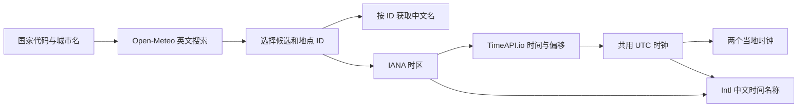

# 此地此刻此身

英文项目名：**Here, Now, Self**，仓库名：[`here-now-self`](https://github.com/Arpx4kun/here-now-self)。此地对应城市与时区，此刻对应时间与作息，此身对应喝水与休息。

网页标题：**此地此刻此身 · 两地时钟，饮水，防熬夜**。

面向横向 16:9 屏幕的静态网页：用壁纸作背景，同时显示两个城市的时间，记录喝水次数，并根据主城市的当地时间提醒休息。默认左侧奥克兰、右侧厦门，支持通过「国家两位代码＋城市名」分别更换。

项目从个人使用场景逐步演进：时钟必须容易看清，壁纸中部下方的人物要保留，喝水操作要简单，夜间提醒逐级增强，进入就寝后保持安静。本文以当前源码为准，结合使用要求和 Git 历史解释配置与抽象的理由。

## 1. 启动与操作

在项目目录启动静态 HTTP 服务：

```powershell
python -m http.server 8765 --bind 127.0.0.1
```

打开 <http://127.0.0.1:8765/index.html>。Python 只提供静态文件，也可以换成其他静态服务器。运行网页不需要 Node.js、npm 安装或构建；运行自动化测试时才需要 Node.js。

首次加载点击中央「开启声音」。50% 黑色遮罩与背景的 `inert` 属性引导先完成一次用户交互，然后恢复界面。后续播放仍受浏览器策略影响；被拒绝时右下角提供声音重试入口。

| 操作 | 当前行为 |
| --- | --- |
| 左 Ctrl | 记录一次喝水、重新计算提醒间隔、撤掉喝水提示、触发彩纸和 Beginning 音效 |
| Z／就寝按钮 | 共用计数；正常状态一次、初级提醒三次、高级提醒十次进入就寝 |
| 就寝中再按 Z／点击按钮 | 一次退出，立即按当地时间恢复对应状态 |
| 配置 | 设置两个城市、饮水量、间隔、三个提醒／恢复时刻，或清零记录 |
| 测试选项 | 模拟主城市时间或测试喝水提醒；再次点击恢复实际状态 |
| 进入全屏 | 调用 Fullscreen API，失败时提示使用 F11 |

键盘操作需网页获得焦点。编辑输入框时忽略全局快捷键；忽略长按重复事件及部分组合键，并通过 `event.code === 'ControlLeft'` 区分左右 Ctrl。右 Ctrl 不记录喝水。

## 2. 文件结构与技术栈

```text
index.html                  HTML、CSS、主业务逻辑和事件绑定
city-clocks.js              城市搜索、双语名称、网络校时与时区信息
assets/Xiaolai-Regular.ttf   小赖字体
assets/OFL.txt              字体许可
9f690…5768.png              当前壁纸
fresh.mp3 等                 本地音效
tests/display.test.cjs       页面状态与喝水功能回归测试
tests/cities.test.cjs        城市及网络时间模块测试
README.md                   使用与设计说明
.gitignore                  忽略预览图及原版备份目录
```

工作区的 `20261012笔记本常驻展示屏v1/` 是原版备份，`preview*` 是开发预览，不参与运行，也不纳入后续提交。原版源码已保存为 Git 首个提交。

| 技术 | 是什么、怎么使用 | 为什么选择 |
| --- | --- | --- |
| HTML／原生 DOM | 页面、表单、动态文字、状态提示 | 单页规模小，静态资源即可运行 |
| CSS Grid／Flexbox | 双时钟比例、信息区、数字基线与按钮排布 | 明确表达 2:1 分区，分别控制对齐和字号 |
| CSS 动画／自定义属性 | 天蓝色渐变、夜间脉冲、随机彩纸轨迹 | 无动画库，视觉与业务状态分开 |
| 原生 JavaScript | 状态、配置、计时与事件 | 无框架、打包器或 npm 运行依赖，便于本地维护 |
| `Intl.DateTimeFormat` | 日期、星期、中文时间名称和时区换算 | 使用浏览器国际化及具名时区数据，避免手写全球规则 |
| `fetch`／`AbortController` | 请求外部 JSON，12 秒超时 | 标准 API，失败时结束等待并保留原状态 |
| `performance.now()` | 网络校准后持续走秒 | 用单调计时计算经过时间，避免系统日期修改影响时钟 |
| `localStorage` | 保存城市、饮水配置、记录和就寝恢复时间 | 无需账户、数据库或后端，适合单设备个人使用 |
| `Audio`／HTMLMediaElement | 播放、停止和重试 MP3 | 直接使用本地文件，无需音频库 |
| Fullscreen API | 用户点击后全屏 | 使用浏览器能力，无桌面程序依赖 |
| Node.js 内置 `vm`／`assert`／`fs`／`path` | 可控时间、DOM、音频、HTTP 的回归测试 | 无测试框架，快速验证时间边界和异步行为 |
| Git | 记录和比较每个版本 | 定位回归、恢复历史实现 |

没有使用 React、Vue、Canvas、Moment、Luxon、Temporal 或 FormatJS。IANA／CLDR 是时区规则和名称所依赖的数据体系，不是本项目安装的 JavaScript 包。

## 3. 布局、字体和视觉反馈

上半屏使用 `grid-template-columns: 2fr 1fr`：左侧主时钟占 2/3，右侧参考时钟占 1/3。时钟块内再区分信息区和数字区：城市与英文名、时间名称与 UTC 偏移、日期与星期依次排列，下面显示大时间。正常、初级和就寝状态左对齐，左侧日期、星期字号一致，均为原日期字号的 1.5 倍；高级状态的日期、星期分两行右对齐，时间名称与 UTC 偏移也分行显示、隐藏分隔点，字号缩小约 20%。秒及前面的冒号独立为 `.seconds`，字号为主时间的一半。

主城市获得更多空间，秒数不再挤压小时和分钟。日期比其他辅助信息突出，地点及日期经过 v3、v4 两次字号调整。`vw`、`vh`、`clamp()`、`min()` 让尺寸随窗口变化；另有窄屏和竖屏基础适配，主要目标仍是 16:9 横屏。

喝水卡片固定在左下，配置和测试按钮放在右下，中央下方留给人物。壁纸使用 `object-fit: cover`、`object-position: center bottom` 铺满屏幕并偏向保留下部内容；不同宽高比可能裁切边缘。

小赖字体通过本地 `@font-face` 加载，`font-display: swap` 避免等待期间无文字，回退到微软雅黑及系统无衬线字体。许可见 `assets/OFL.txt`。当前没有独立粗体文件，加粗由浏览器处理。

喝水提醒的全屏层为天蓝色 `#87ceeb`，透明度按 `.9s ease-in-out` 渐变亮起再暗下，重复三次，总计约 2.7 秒。`animationend` 后显示底部文字：

> 喝两口水，活动活动肩膀，把右肩往上抬抬。 · 按左 Ctrl 记录

上述为默认横幅文字，可在配置中编辑并保存，也可点「恢复默认文字」后保存。内容须为 1–300 字，以 `textContent` 显示纯文本；旧配置自动补默认值，测试模式中的文案修改不写真实存储。

它保留原提醒节奏，同时减少突然亮起和消失的突兀感。高级休息提醒使用独立的红色脉冲动画，周期 1.2 秒。效果层设置 `pointer-events: none`，避免阻挡操作。

每次喝水反馈生成 80 个 DOM 彩纸片，以 CSS 变量设置随机颜色、方向、高度和旋转，1.8–2.8 秒后移除。生成前清理过多旧片，避免长时间堆积；当前实现瞬时可达到 240 片。

高级防熬夜状态在红色大时钟下方、现有操作提示右侧显示四行睡眠提示，字号为初版提示的 1.5 倍。文案为「现在入睡，洗漱完睡满 8 小时后／将到 HH:mm 才可恢复。／别让补觉占掉上午，甚至下午。／现在就睡吧。」时间随时钟更新，预留半小时洗漱，加八小时睡眠，再换算到主城市，兼容跨日与夏令时变化；离开高级状态即隐藏。此文案是个人提醒，计算的是八小时半后的时刻，并非恢复精力的医学保证。

## 4. 城市与时间模块

### 为什么分开存城市、时区和偏移

选定地点的结构类似：

```js
{
  id: 2193733, // 地点唯一 ID；初始内置城市还没有此字段
  country: 'NZ',
  english: 'Auckland',
  chinese: '奥克兰',
  zone: 'Pacific/Auckland'
}
```

名称用于显示，地点 ID 用于获取同一个地点的译名，IANA 时区用于时间规则。当前 UTC 偏移是某个时刻的结果，不是地点身份：`Pacific/Auckland` 会切换偏移，固定的 `UTC+13:00` 不能代表其完整规则。

国家代码缩小搜索范围，但无法消除一国内的同名地点。因此展示省／州、次级行政区和国家，让用户选择候选，不直接采用第一项。

### 两个 API 与浏览器分别负责什么



**Open-Meteo Geocoding／GeoNames 负责地点。** 搜索使用 `name`、`countryCode`、`language=en`、`count=30`。过滤国家不符、无地点 ID 或时区的结果，依次优先 `PPLC` 首都、`PPLA…` 行政区驻地、`PPL…` 其他聚居地，最后才是机场等地点；同类按人口降序，最多展示 12 项。

选择后用 `/v1/get?id=…&language=zh` 获取该地点中文名，再立即保存并应用。译名缺失时保留原名并提示；译名可能含繁体字、行政单位后缀，当前不做机器翻译、简繁转换或名称清洗。

**TimeAPI.io 负责网络时间与实际偏移。** 调用 `/api/timezone/zone?timeZone=…`，读取 `currentLocalTime`、`currentUtcOffset.seconds` 和可用的 `dstInterval`。同步成功后，显示时钟无需依赖电脑当前日期判断当地时间。

**Intl 负责中文时间叫法。** `zh-CN`、`timeZoneName: 'long'` 配合时区与时间点，得到「新西兰夏令时间」「中国标准时间」等文字。名称和实际偏移分开显示，不把所有地区强行归为冬令时／夏令时。具体措辞及回退形式取决于浏览器数据版本。

选择这一组合，是为了让个人静态网页无需注册 Key、启用云账户计费或部署凭据代理。地点查询、网络时间和中文名称各司其职；免费服务仍有政策和可用性约束，不代表无限调用或永久承诺。来源：[Open-Meteo 文档](https://open-meteo.com/en/docs/geocoding-api)、[TimeAPI 说明](https://timeapi.io/home/faqs)、[CLDR 中文名称](https://github.com/unicode-org/cldr-json/blob/main/cldr-json/cldr-dates-full/main/zh/timeZoneNames.json)。

### 一条 UTC 时间线，两个当地时钟

`CityClocks` 用立即执行函数形成模块，内部保留城市、网络快照、校时锚点、同步状态和格式器缓存，通过方法与 `onChange` 回调连接主页面。它也管理城市设置 DOM，目前不是完全独立于页面的通用库；小项目的其余业务留在 `index.html`。

网络返回的当地时间没有偏移后缀，直接 `new Date(localTime)` 会被系统默认时区解释。`parseNetwork()` 将当地字段先按 UTC 解析，再减去返回偏移，得到真正的 UTC；超出毫秒精度的尾数截断为毫秒。

锚点记录网络 UTC 和接收时的 `performance.now()`，并以请求往返耗时的一半近似补偿网络延迟：

```text
当前 UTC = 校准 UTC + 当前单调计时 − 校准时单调计时
当地时间 = 当前 UTC + 当地实际偏移
```

两个时钟共用一个 UTC 锚点，通常由左侧同步更新；尚无锚点时右侧也可首次校准。两地显示同一瞬间，避免请求返回时间不同造成秒数错位。页面每 250 毫秒刷新，网络请求不随刷新发生。

启动、每日定时、手动同步和网络恢复时校时。每日对时默认开启，按左侧主城市当地 04:00 查询两个时钟的 API；配置可关闭或修改时刻。日程使用 `nextLocalTime()` 换算，跟随城市和夏令时，错过多天后只补一次，测试模式不发起定时请求；此机制替代原先每 30 分钟同步。页面恢复可见、`pageshow` 也检查同步，恢复事件有 60 秒节流。同一地点避免并行重复校时，请求 12 秒超时。搜索与城市配置带版本号，忽略输入／地点变化前发出的旧结果，防止晚到响应覆盖新选择。

偏移用秒保存，格式为 `UTC±HH:mm`，支持 `+05:30`、`+05:45`。实际显示优先使用网络偏移，并根据已返回的夏令时区间调整；无网络数据和测试模式改用 Intl。返回区间不能覆盖所有未来政策变化，仍需重新同步。

首次同步失败暂用电脑时间；之后失败沿用当前页面内的锚点。锚点不持久化，刷新后需重新校时。同步状态在配置中显示。

## 5. 喝水目标、提醒与作息日

默认每 20 分钟提醒，目标 1800 毫升。「两口水」约定为一次记录、50 毫升，因此目标次数是 `volume / 50`，默认 36 次。这是个人配置和记录单位，不是每次实际测量的水量。

饮水量接受 50–20000 内的 50 倍数，保证目标次数为整数；间隔接受 1–1440 分钟整数。次数上限、提示文字、进度条和完成状态从配置派生，不分别维护「1800」和「36」。达到目标后计数不再增加，按键仍触发反馈；调低目标不删除已有次数，进度最大显示 100%。完成目标不会自动关闭定时提醒。

`state` 保存 `count`、`lastPressed`、`day`。早期「六小时没有按键就清零」已由 v5 的每日恢复时刻替代；`lastPressed` 仍记录，但不再用于清零判断。

`waterDay()` 按左侧城市的恢复时刻划分作息日：默认 07:30 前属于前一天，07:30 起属于新一天。标签改变就清零，避免午夜切断同一晚的记录。更换左侧城市保留次数、重标喝水日；若正在就寝，也重算恢复时间。

定时喝水用 `CityClocks.utcNow()` 与 `nextWaterReminderAt` 比较，不跟随模拟日期。默认推荐间隔 20 分钟，可在配置中修改。从最近一次记录喝水开始，在间隔的整数倍（20、40、60…分钟）提醒，每次按左 Ctrl 后重新起算；刷新会读取保存的最后记录时间。尚无喝水记录时从页面启动起算。后台暂停错过多次间隔后，只提醒一次并推进到原起点的下一个整数倍，不补播积压。修改间隔、退出就寝会按最后记录重新安排下一次，避免补播就寝期间的提醒。

## 6. 四状态模型与就寝优先级

v14、v15 处理的关键问题是：时间驱动提醒与用户主动就寝来自不同入口。用隐藏提示或暂时恢复正常的标记，容易导致午夜不提醒，或进入就寝后又被一点提醒覆盖。

当前 `displayState` 的核心是：

```js
{ mode: 'sleep', wakeAt: /* UTC 毫秒时间戳 */, presses: 0 }
```

| 状态 | 默认条件 | 行为 | 进入就寝次数 |
| --- | --- | --- | --- |
| `normal` | 07:30–次日 00:00 | 双时钟，喝水提醒开启 | 1 |
| `soft-reminder` | 00:00–01:00 | 主时钟变红，参考时钟与喝水提醒保留 | 3 |
| `strong-reminder` | 01:00–07:30 | 主时钟放大红色脉冲，隐藏参考时钟，保留喝水框和提醒 | 10 |
| `sleep` | 任意状态完成进入操作 | 屏蔽休息／喝水提醒及持续提醒音效，显示就寝说明 | 1 次退出 |

所有时间条件跟随左侧城市，三个时刻均可配置。高级状态的放大数字仍在上半屏，背景遮罩作用于全屏；当前不是数字铺满整个屏幕。

`scheduledMode()` 根据当地时间计算正常／初级／高级状态。`updateDisplayState()` 先检查就寝，未到 `wakeAt` 直接返回，时间不能抢占就寝；恢复时刻才退出。`transitionMode()` 集中处理停止旧音效、清除喝水提醒、重置累计次数、保存和渲染，并根据转换原因播放音效。

音效由状态转换触发，而非每次刷新反复播放。Z 与按钮共用 `toggleSleep()`，次数可混合累计。手动退出就寝后立即恢复当地时间对应状态，没有额外免提醒期。

配置按循环日内顺序校验「初级 → 高级 → 恢复」，允许跨午夜，例如 22:30、23:30、08:00。恢复时刻属于本地日历概念，`nextLocalTime()` 不简单加 24 小时，而用主时区反算 UTC。转换迭代四次并验证往返结果；若时刻被夏令时跳过，最多向后搜索 180 分钟，取首个有效时刻。尚无通用重复时刻选择或整日跳过策略。

就寝中左 Ctrl 仍能记录次数和显示彩纸，但记录音效被屏蔽。就寝控制提醒，不禁用饮水输入。

## 7. 音效与异步播放

| 文件 | 当前用途 |
| --- | --- |
| `fresh.mp3` | 定时／测试喝水提醒 |
| `aesthetic.mp3` | 进入初级休息提醒 |
| `fragrance.mp3` | 进入高级休息提醒 |
| `cheerful.mp3` | 手动／自动退出就寝及恢复预设测试 |
| `music.mp3` | 进入就寝 |
| `begining.mp3` | 记录喝水 |
| `instant.mp3`、`hearty.mp3` | 早期饮水音效，当前不调用 |

`begining.mp3` 是现有文件名，代码沿用该拼写。音效预加载，播放前回到起点。`stopSounds()` 暂停所有音频、归零位置、清空待播放队列，并递增 `soundGeneration`。

这个代数标记识别过期的异步 `play()` 结果，防止进入就寝后旧提醒又排队补播。就寝只允许进入音效 Music；退出后播放 Cheerful。自动播放被拒绝时记录待播放项目并显示重试入口，其他加载失败也有提示。

## 8. 本地存储与测试隔离

| 存储键 | 内容 |
| --- | --- |
| `clock-cities-v1` | 两个地点的名称、国家、ID、时区 |
| `water-settings-v1` | 间隔、饮水目标、横幅文字、三个提醒／恢复时刻和每日对时开关／时刻 |
| `water-display-v1` | 次数、最后记录时间、喝水日 |
| `display-state-v1` | 状态、恢复时间、操作计数；重载主要恢复就寝 |
| `sleep-display-v1` | 旧版就寝数据兼容读取 |

读入数据有校验，存储不可用时当前页面仍可使用。没有账户、云同步和多标签页协调；多标签页可能覆盖持久数据。更换浏览器、清除站点数据、更换域名或端口会影响保存数据的可见性。

测试通过 `testOffset` 偏移当前 UTC，不改操作系统时间。进入时保存喝水、状态、配置、提醒计划快照；模拟操作不写真实存储，禁止选城市和应用校时结果。退出恢复快照，撤掉假的闪烁、文字与音效，再按真实时间计算状态。

选择预设或修改时间直接应用，无需额外按钮。恢复预设构造「就寝恢复时刻刚到」和「上一喝水日」，走真实恢复与清零路径，因而也会触发 Cheerful。普通时间输入会拒绝夏令时跳过的不存在时刻。

## 9. 测试与验证

```powershell
node tests/display.test.cjs
node tests/cities.test.cjs
```

`display.test.cjs` 将页面和城市脚本加载进 Node `vm`，替换日期、DOM、计时器、音频和存储，验证四状态、午夜／一点边界、Z／按钮计数、就寝屏蔽、自动恢复音效、清零、配置、左 Ctrl、彩纸清理、测试恢复、跨午夜、奥克兰夏令时跳过时刻，以及纽约／尼泊尔换算。

`cities.test.cjs` 模拟 HTTP，验证城市优先、双语名称与保存、错误系统日期下的网络走秒、非整小时偏移、非法响应、测试隔离和断网回退。

测试不连接真实服务，也不证明字体、布局、动画或自动播放始终正常。视觉和联网改动仍需浏览器检查 16:9 正常／高级状态、重名搜索、声音授权、网络同步。v18 已实际验证厦门、加德满都搜索及 `UTC+05:45` 显示。

## 10. Git 演进与设计形成

| 版本 | 提交 | 改动与设计 |
| --- | --- | --- |
| v1 | `9adce44` | 保存第一版，建立可恢复基线 |
| v2–v4 | `d555370`、`744fc01`、`97808bc` | 16:9、时间测试、字号与左对齐；主时钟优先、信息分层 |
| v5 | `a333d07` | 当地 07:30 清零，按作息日保存饮水记录 |
| v6–v8 | `29a7014`、`538a435`、`0deb1da` | 喝水闪烁、彩纸、Z 就寝、提示位置与字距 |
| v9–v12 | `74e5353`、`fb941f8`、`0628681`、`1bc9471` | 天蓝渐变、音效、配置、声音引导和测试入口简化 |
| v13–v14 | `5bbc286`、`59139d6` | 可配置夜间时刻、测试提示清理、真实午夜提醒修复及音效更新 |
| v15 | `a7baeed` | 四状态重构；就寝优先，转换副作用集中处理 |
| v16–v17 | `b13486f`、`5f5826e` | 高级状态保留饮水框、按钮同计数、恢复测试音效及 Cheerful |
| v18 | `c1253ac` | 两地可配置，无 Key 查询、网络校时、中文名称和实际偏移 |

```powershell
git log --reverse --oneline
git show a7baeed
git show c1253ac
```

代码中的 `auckland`、`china`、`aucklandInputToDate()` 是历史命名；当前分别指左侧主城市、右侧参考城市，以及主城市时间反算，不表示功能仍固定在奥克兰或中国。

## 11. 资源调整与当前边界

更换壁纸需修改背景 `src` 和末尾 `images` 数组；多张图片每 60 秒轮换。静态网页不会自动枚举文件夹新图片。更换音效需保留原文件名，或同步修改音效列表与播放调用。

- 网络延迟补偿是近似值，显示到秒不是授时精度保证。刷新后内存锚点丢失，需重新同步。
- 时钟及喝水间隔使用同一网络时钟；首次校时前仍回退到电脑时间，网络校准跳变可能改变当前提醒的剩余时间。
- 中文名称和提醒／恢复换算使用浏览器时区数据；与服务数据版本不一致时，可能与网络偏移存在差异。
- 搜索不是全球完整行政区划名录；没有自动定位、手动 IANA 输入、中文名称编辑和离线地点库。
- 当前本地时间反算不覆盖所有历史或政治性跳变，也无显式重复时间选择策略；扩大调度场景时可考虑成熟日期库。
- 长名称可能换行，竖屏只基础适配；没有防烧屏、Wake Lock、Windows 亮度控制或开机启动。
- 没有后台服务或系统调度；页面关闭、浏览器冻结、电脑休眠时不能保证按时提醒。

字体使用 `assets/OFL.txt` 的 SIL OFL 1.1。仓库未声明代码的独立许可证，也没有壁纸与音效的再分发许可说明；字体许可不自动覆盖这些资源。地点及时间来源已在页面配置中署名。
